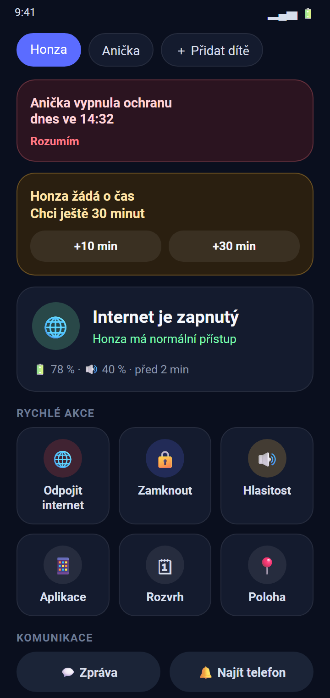
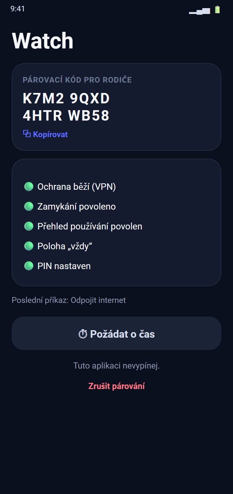
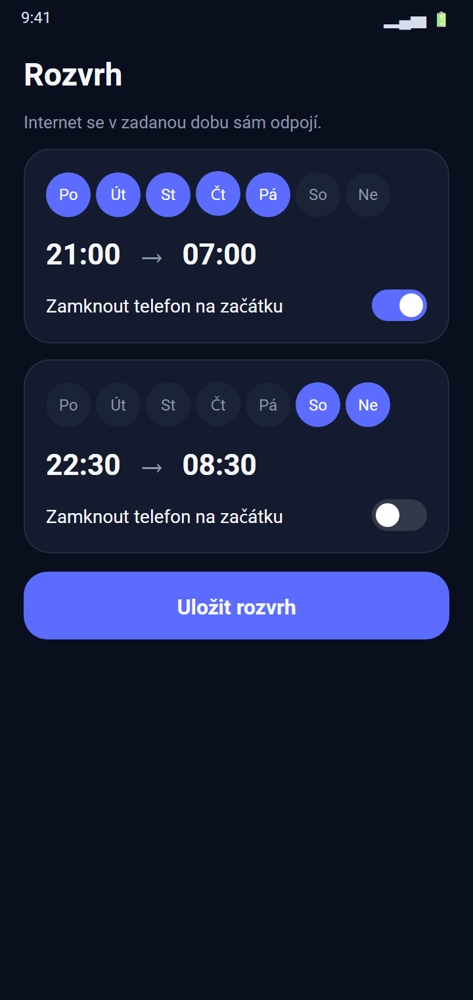
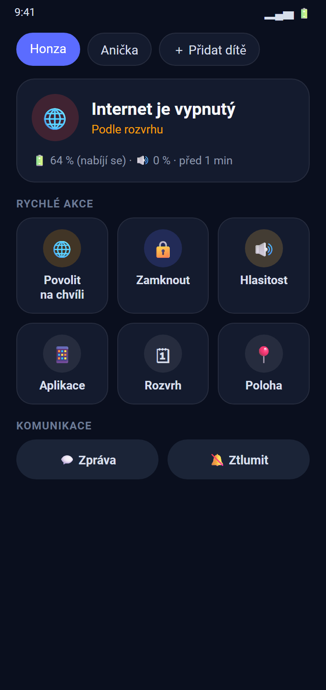
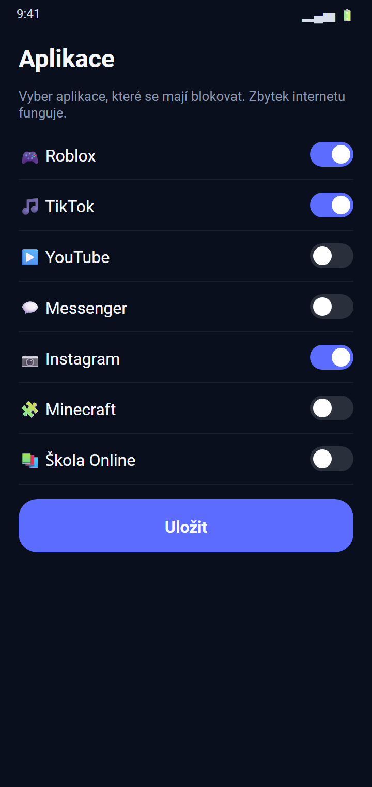
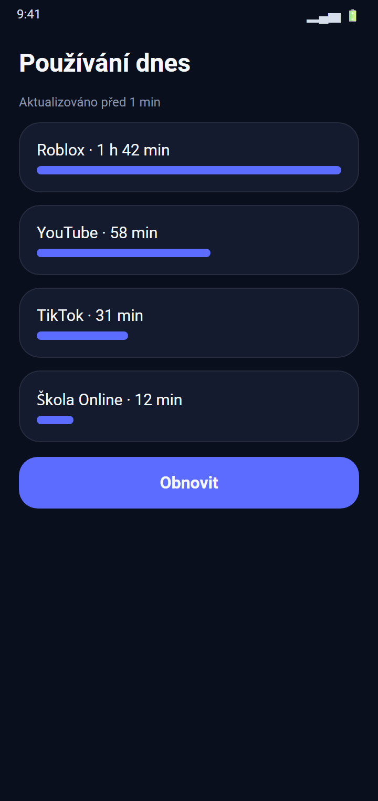
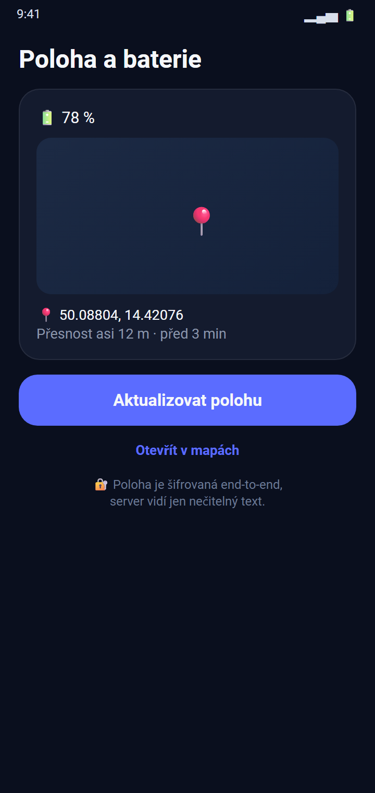

<div align="center">

# 🛡️ Watch

**Hlídání dětských telefonů na dálku — jedna aplikace, dva režimy, vlastní server.**

[🇬🇧 English](README.md) · 🇨🇿 Čeština






</div>

> Obrázky jsou ilustrační vykreslení obrazovek aplikace (ukázková data), nejde o snímky z telefonu.

## ✨ Funkce

| | |
|---|---|
| 🌐 **Odpojení internetu** | Dokud ho nezapneš, nebo na 15 min – 2 h. Dočasné povolení jedním klepnutím. |
| 🔒 **Zamknutí a zpráva** | Zamkni telefon na dálku a pošli dítěti zprávu. |
| 🔔 **Najít telefon** | Hlasité zvonění, i když je telefon ztlumený. |
| 📵 **Blokování aplikací** | Zablokuj jen vybrané aplikace — zbytek internetu funguje. |
| 🗓 **Rozvrh** | Např. každou noc se internet sám odpojí (volitelně i zamkne telefon). |
| 📊 **Přehled používání** | Které aplikace dnes dítě používalo a jak dlouho. |
| 📍 **Poloha a baterie** | Poslední poloha na mapě a stav baterie. |
| ⏱ **Žádosti o čas** | Dítě může požádat o čas; rodiči přijde notifikace s tlačítky +10 / +30 min. |
| 🚨 **Upozornění na zásah** | Dostaneš zprávu, když dítě vypne ochranu. PIN chrání před zrušením párování. |
| 👨‍👩‍👧‍👦 **Více dětí** | Spáruj libovolný počet telefonů a mezi dětmi přepínej. |

## 🔐 Soukromí na prvním místě

Citlivé údaje (poloha, používání aplikací, seznam aplikací, zprávy) jsou **šifrované end-to-end** (AES-GCM).
Klíč se odvozuje z tajné poloviny párovacího kódu, která se **nikdy neposílá na server** —
server přeposílá jen nečitelný text. Žádné služby Google, žádná analytika, žádný cizí backend:
malý přenosový server si provozuješ sám.

## 🧩 Jak to funguje

```
 Telefon rodiče  ──wss──►  Tvůj server (Node.js + WebSocket)  ◄──wss──  Telefon dítěte
    (příkazy)                přeposílá příkazy a stav                  (VPN blokace, zámek, poloha)
```

Internet se blokuje lokální VPN službou, která provoz prostě zahodí — nic neopouští telefon.

## 🚀 Začínáme

### 1. Server
Nasaď přenosový server ze složky [`server/`](server/README.md) (Node.js 18+, za HTTPS reverzní proxy, např. Nginx).

### 2. Sestavení aplikace
```bash
cp gradle.properties.example gradle.properties   # a nastav serverUrl=wss://tvoje-domena/ws
./gradlew assembleDebug                          # nebo assembleRelease s vlastním klíčem
```
Potřebuješ JDK 17+ a Android SDK. Podpis release verze používá `keystore/keystore.properties` (v repozitáři není).

### 3. Spárování telefonů
- **Telefon dítěte:** otevři Watch → „Telefon dítěte“ → povol VPN → nastav PIN → povol zamykání, přehled používání a polohu („vždy“). Aplikace zobrazí párovací kód.
- **Telefon rodiče:** otevři Watch → „Jsem rodič“ → „＋ Přidat dítě“ → zadej jméno a kód.

### 4. Zpevnění dětského telefonu
- U Watch nastav v baterii „Bez omezení“.
- Nastavení → Síť → VPN → Watch → zapni „Trvalá VPN“.
- Dítě může aplikaci odinstalovat nebo vypnout správce zařízení (rodič dostane upozornění); úplné zamčení umí jen režim Device Owner.

## 📱 Další obrazovky

<table>
<tr>
<td align="center"><br>Internet vypnutý rozvrhem</td>
<td align="center"><br>Blokování aplikací</td>
<td align="center"><br>Používání dnes</td>
<td align="center"><br>Poloha a baterie</td>
</tr>
</table>

## 🛠 Technologie
Nativní Android (Kotlin, bez UI knihoven) · `VpnService` · `DeviceAdminReceiver` · foreground služby · Node.js + `ws` · end-to-end šifrování.

## 🌍 Jazyky

Aplikace se řídí jazykem telefonu. Aktuálně je k dispozici **English** (výchozí) a **Čeština**.
Na Androidu 13+ jde jazyk nastavit i pro každou aplikaci zvlášť: *Nastavení → Aplikace → Watch → Jazyk*.

Přidání překladu jsou dva kroky:
1. Zkopíruj [`app/src/main/res/values/strings.xml`](app/src/main/res/values/strings.xml) do `app/src/main/res/values-<kód>/strings.xml` (např. `values-de`) a přelož texty.
2. Přidej `<locale android:name="<kód>" />` do [`res/xml/locales_config.xml`](app/src/main/res/xml/locales_config.xml).

Pull requesty s dalšími jazyky jsou vítané.

## 📄 Licence
Licence zatím nebyla zvolena — všechna práva vyhrazena autorovi.

---
<div align="center">Vytvořil <a href="https://github.com/eHappyCZ">eHappyCZ</a> · <a href="https://portible.eu">Portible.eu</a> · <a href="mailto:dev@portible.eu">dev@portible.eu</a></div>
