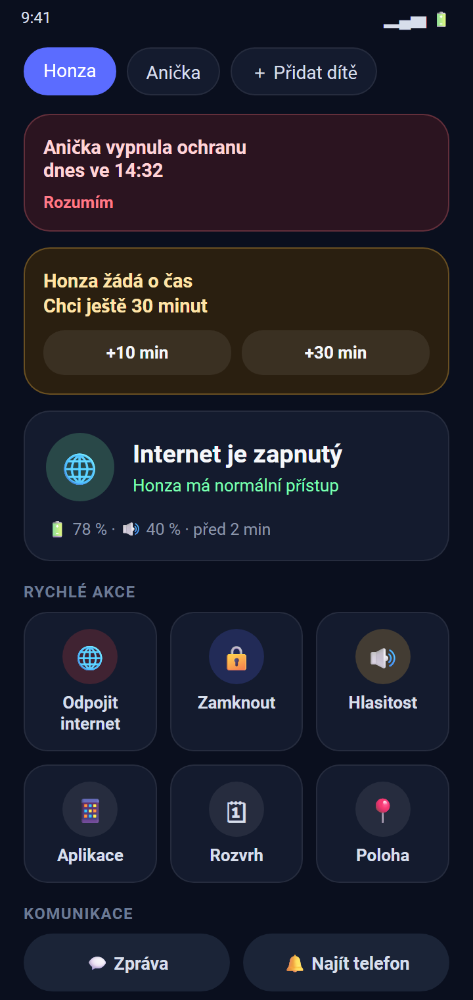
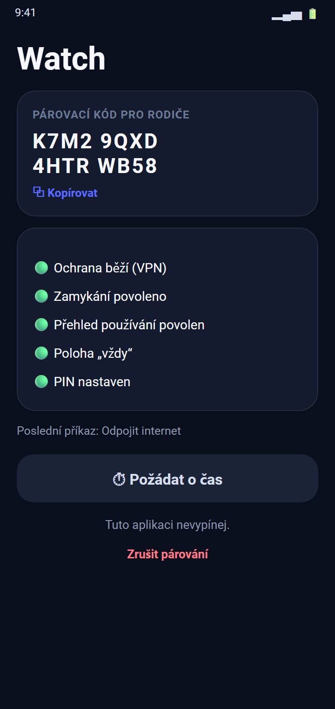
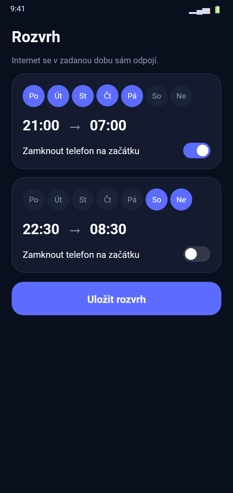
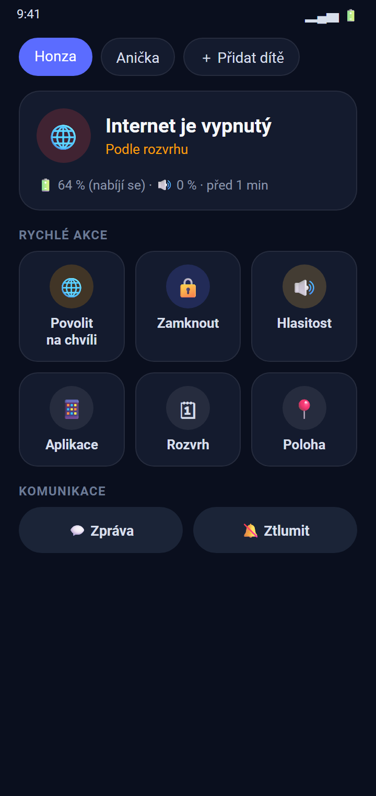
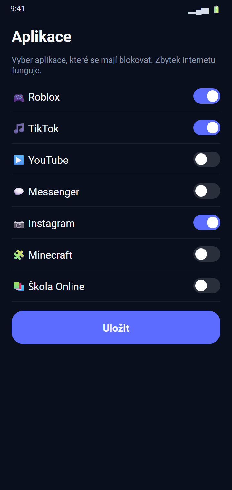
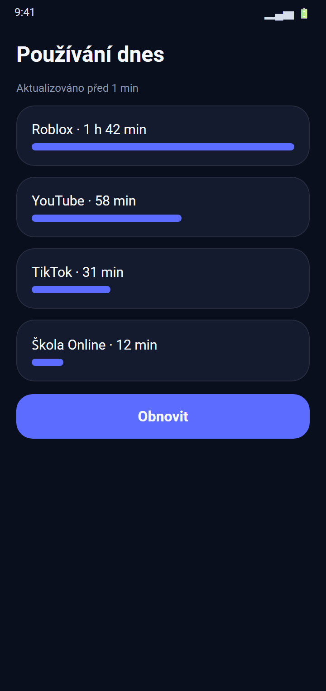
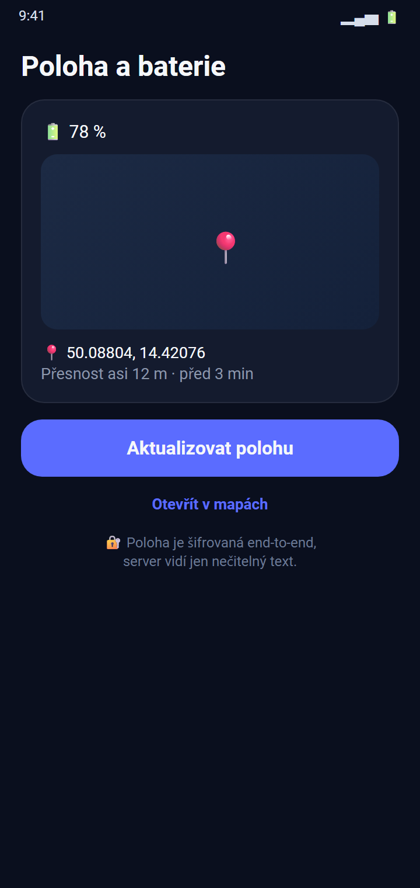

<div align="center">

# 🛡️ Watch

**Remote parental control for your kids' Android phones — one app, two modes, your own server.**

🇬🇧 English · [🇨🇿 Čeština](README.cs.md)






</div>

> The images are illustrative renderings of the app's screens (sample data), not device screenshots.

## ✨ Features

| | |
|---|---|
| 🌐 **Internet cut-off** | Disconnect until you re-enable it, or for 15 min – 2 h. Temporarily allow access with one tap. |
| 🔒 **Lock & message** | Lock the screen remotely and send a message to your child. |
| 🔔 **Find my phone** | Make the phone ring loudly, even when muted. |
| 📵 **App blocking** | Block selected apps only — the rest of the internet keeps working. |
| 🗓 **Schedules** | e.g. cut the internet (and optionally lock the phone) every night. |
| 📊 **Usage overview** | See which apps were used today and for how long. |
| 📍 **Location & battery** | Last known position on the map and battery level. |
| ⏱ **Time requests** | Your child can ask for more time; you get a notification with +10 / +30 min buttons. |
| 🚨 **Tamper alerts** | Get notified when protection is switched off. A PIN protects against un-pairing. |
| 👨‍👩‍👧‍👦 **Multiple children** | Pair as many phones as you like and switch between them. |

## 🔐 Privacy first

Sensitive data (location, app usage, installed apps, messages) is **end-to-end encrypted** (AES-GCM).
The key is derived from the secret half of the pairing code, which is **never sent to the server** —
the server only relays opaque ciphertext. No Google services, no analytics, no third-party backend:
you host the tiny relay server yourself.

## 🧩 How it works

```
 Parent phone  ──wss──►  Your server (Node.js + WebSocket)  ◄──wss──  Child phone
   (commands)              relays commands & status                (VPN block, lock, location)
```

Internet blocking is done with a local VPN service that simply drops traffic — nothing leaves the phone.

## 🚀 Getting started

### 1. Server
Deploy the relay in [`server/`](server/README.md) (Node.js 18+, behind an HTTPS reverse proxy such as Nginx).

### 2. Build the app
```bash
cp gradle.properties.example gradle.properties   # then set serverUrl=wss://your-domain/ws
./gradlew assembleDebug                          # or assembleRelease with your own keystore
```
Requires JDK 17+ and the Android SDK. Release signing uses `keystore/keystore.properties` (not included in the repo).

### 3. Pair the phones
- **Child phone:** open Watch → *Child's phone* → allow VPN → set a PIN → grant lock, usage-access and location ("always"). The app shows a pairing code.
- **Parent phone:** open Watch → *I'm a parent* → *＋ Add child* → enter a name and the code.

### 4. Harden the child phone
- Set battery usage for Watch to *Unrestricted*.
- Settings → Network → VPN → Watch → enable *Always-on VPN*.
- A child can still uninstall the app or disable the device admin (you get an alert); a full lock-down requires Device Owner mode.

## 📱 More screens

<table>
<tr>
<td align="center"><br>Internet blocked by schedule</td>
<td align="center"><br>App blocking</td>
<td align="center"><br>Daily usage</td>
<td align="center"><br>Location & battery</td>
</tr>
</table>

## 🛠 Tech stack
Native Android (Kotlin, no UI libraries) · `VpnService` · `DeviceAdminReceiver` · foreground services · Node.js + `ws` · end-to-end encryption.

## 🌍 Languages

The app follows the phone's language. Currently available: **English** (default) and **Čeština**.
On Android 13+ you can also pick a language per app in *Settings → Apps → Watch → Language*.

Adding a translation takes two steps:
1. Copy [`app/src/main/res/values/strings.xml`](app/src/main/res/values/strings.xml) to `app/src/main/res/values-<code>/strings.xml` (e.g. `values-de`) and translate the texts.
2. Add `<locale android:name="<code>" />` to [`res/xml/locales_config.xml`](app/src/main/res/xml/locales_config.xml).

Pull requests with new languages are welcome.

## 📄 License
No license has been chosen yet — all rights reserved by the author.

---
<div align="center">Made by <a href="https://github.com/eHappyCZ">eHappyCZ</a></div>
